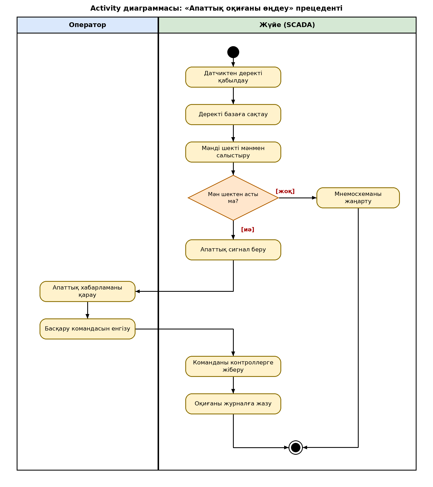
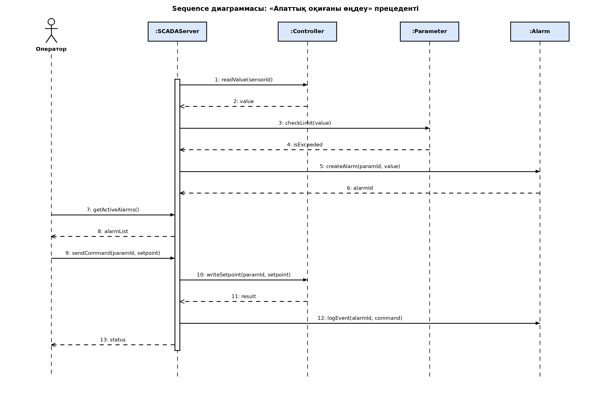

# Мұнай өнеркәсібінде SCADA негізінде технологиялық процестерді мониторингтеуге және басқаруға арналған ақпараттық жүйені әзірлеу және енгізу

Автор: Шанытбай Дарын, Вт(КИ)-к-24-1а

## Мәселе
Мұнай өнеркәсібінде технологиялық процестердің (қысым, температура, ағын, деңгей) параметрлерін қолмен бақылау баяу әрі қателікке бейім, апаттық жағдайға кеш әрекет ету қаупін туғызады. Жоба датчиктер мен контроллерлерден деректерді нақты уақытта жинайтын, параметр шектен асқанда апаттық сигнал беретін және операторға қашықтан басқару мүмкіндігін беретін SCADA негізіндегі ақпараттық жүйені әзірлейді. Жүйе операторларға, инженер-технологтарға және әкімшілерге керек.

## Акторлар
- Оператор
- Инженер-технолог
- Әкімші

## Талаптар
### Функционалдық
1. Жүйе датчиктер мен контроллерлерден технологиялық параметрлерді нақты уақытта қабылдауы керек
2. Жүйе параметр мәндерін мәліметтер базасына сақтауы керек
3. Жүйе параметр шекті мәннен асқанда апаттық сигнал беруі керек
4. Жүйе операторға басқару командасын контроллерге жіберуге мүмкіндік беруі керек
5. Жүйе барлық апаттық оқиғалар мен командаларды журналға жазуы керек

### Функционалдық емес
1. Деректерді жаңарту кідірісі 1-2 секундтан аспауы керек
2. Жүйе тәулік бойы үздіксіз жұмыс істеуі керек
3. Рөлдер бойынша қолжетімділік бөлінуі керек (оператор, инженер, әкімші)

## Диаграммалар
### 1. Use Case
<!-- Кейін толтырылады: 1-жұмыс -->

### 2. Class
<!-- Кейін толтырылады: 2-жұмыс -->

### 3. Activity: Апаттық оқиғаны өңдеу

### 4. Sequence: Апаттық оқиғаны өңдеу

